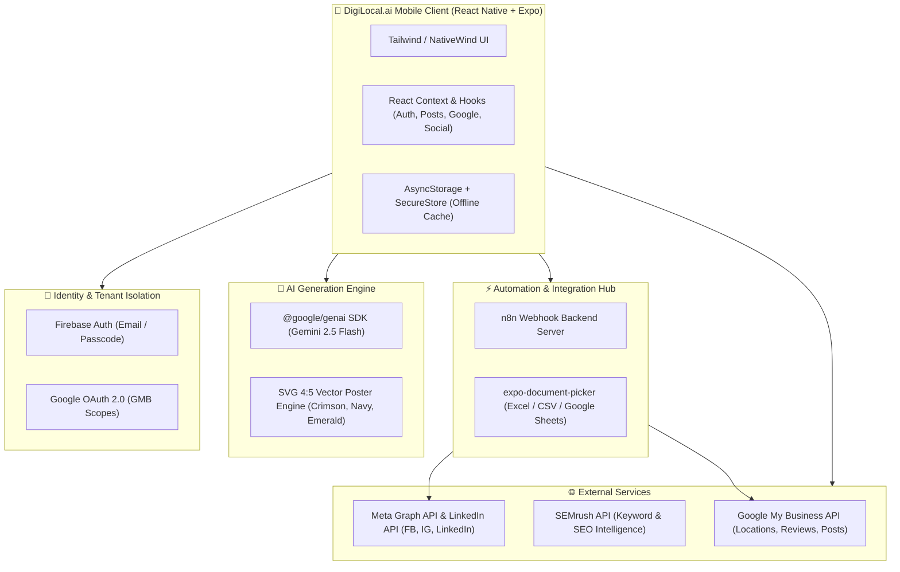

# 🚀 DigiLocal.ai — Enterprise Local SEO & Omnichannel Marketing Automation Platform

[](https://reactnative.dev/)
[](https://expo.dev/)
[](https://www.typescriptlang.org/)
[](https://www.nativewind.dev/)
[](https://firebase.google.com/)
[](https://ai.google.dev/)
[](https://n8n.io/)

---

## 📖 Executive Summary

**DigiLocal.ai** is a production-grade, multi-tenant mobile platform built for businesses, digital marketing agencies, and franchise enterprises managing single or multi-location **Google Business Profiles (GMB / GBP)** and social media channels. 

The application unifies:
1. **Google My Business (GMB) Management** — Direct location syncing, real-time analytics (views, clicks, calls), and profile audits.
2. **AI-Powered Festival Creative Studio** — Instant 4:5 vertical commercial posters and SEO captions tailored to Indian festival calendars and business niches.
3. **Omnichannel Social Auto-Publishing** — Automated cross-posting to Google Profile, Facebook Pages, Instagram Business, and LinkedIn Company Pages.
4. **Manual Bulk Spreadsheet Scheduling** — Full workflow integration with **n8n** backend, allowing users to upload Excel (`.xlsx`, `.xls`), CSV, or paste Google Sheets links to schedule entire month-long campaigns with zero manual intervention.
5. **AI Reputation Management** — Google review sentiment analysis and 1-tap contextual AI review responses.
6. **Local SEO & Search Intelligence** — SEMrush API-powered search volume tracking, keyword positions, and local pack consistency audits.

---

## 🏛️ System Architecture



---

## 🛠️ Tech Stack & Dependencies

### 1. Core Framework & Language
| Technology | Version | Purpose |
| :--- | :--- | :--- |
| **React Native** | `0.86.3` | High-performance cross-platform mobile engine |
| **Expo** | `~57.0.24` | Universal React workflow, native runtime, dev client |
| **TypeScript** | `~6.0.3` | Static typing, interface definitions, enterprise code safety |
| **React Navigation** | `v7.x` | Bottom tabs, native stack transitions, deep linking |

### 2. Styling & Visual Presentation
| Library | Purpose |
| :--- | :--- |
| **NativeWind** (`v4.2.7`) & **TailwindCSS** | Utility-first responsive styling for native components |
| **react-native-svg** (`v15.15.4`) | High-resolution 4:5 vertical vector poster rendering |
| **lucide-react-native** (`v1.47.0`) | Modern, lightweight vector icon system |

### 3. File & Document Handling
| Library | Purpose |
| :--- | :--- |
| **expo-document-picker** | Native file browser supporting Microsoft Excel (`.xlsx`, `.xls`) and CSV files up to 10MB |

### 4. Authentication, Security & Storage
| Technology | Implementation Details |
| :--- | :--- |
| **Firebase Auth** (`v12.19.0`) | User profiles, tenant isolation, session persistence |
| **Google Sign-In** | `@react-native-google-signin/google-signin` + `expo-auth-session` for GMB OAuth 2.0 scopes |
| **expo-secure-store** | Encrypted hardware-backed keychain storage for sensitive tokens |
| **AsyncStorage** | Fast offline JSON cache for scheduled posts, drafted campaigns, and connectors |

### 5. AI & Generative Posters
| Technology | Purpose |
| :--- | :--- |
| **@google/genai** (`v2.24.0`) | Official Google GenAI SDK running Gemini 2.5 Flash for post copy, hashtag research, and poster prompts |
| **SVG Poster Engine** (`gemini.ts`) | Dynamic 4:5 vertical commercial poster renderer with custom brand name extraction, category icons, ornate gold borders, and festive discount badges |

### 6. Workflow Automation & Webhooks
| Technology | Purpose |
| :--- | :--- |
| **n8n Workflow Automation** | Cloud background engine executing multi-channel posts, parsing uploaded sheets, and dispatching to social APIs |
| **Axios** (`v1.20.0`) | HTTP client with load-balanced failover and timeout handlers |

---

## 📱 Core Features & Module Breakdown

### 1. 🎨 AI Poster Studio (`PostsScreen.tsx`)
- **Step 1: Choose Occasion** — Accurately mapped Indian festivals and national events (Navratri, Dussehra, Karwa Chauth, Dhanteras, Diwali, Govardhan Puja, Bhai Dooj, Chhath Puja, Republic Day, Independence Day, etc.).
- **Step 2: Business & Festive Offer** — Smart auto-extraction of clean brand names (e.g. extracts *"DigiBirds"* from long GMB titles), business niche input, and optional festive coupon badges.
- **Step 3: 4:5 Vertical Poster Preview** — Full vertical aspect ratio with 3 designer themes:
  - 🔴 **Crimson Gold** (Classic Indian Festive)
  - 🔵 **Royal Navy** (Corporate & Premium Real Estate)
  - 🟢 **Emerald Gold** (Prosperity & Wellness)
  - Full-screen modal viewer with zoom & regenerate controls.
- **Step 4: SEO Captions & Channels** — Multi-tab copy switcher (Google Business Update vs. Social Media Caption with emojis and hashtags) + 1-tap channel checkboxes.
- **Action Suite**:
  - `Save Draft`: Stored locally for approval.
  - `Schedule`: Assigns calendar date/time for automatic cloud dispatch.
  - `Post Now`: Immediate broadcast via n8n backend.

---

### 2. 📊 Manual Bulk Spreadsheet Upload (`PostsScreen.tsx`)
Designed for agencies and power users who prepare content calendars in spreadsheets:
- **Google Sheets Mode**: Enter a public/shared Google Sheet link (`https://docs.google.com/spreadsheets/d/...`).
- **Excel / CSV Upload Mode**: Pick `.xlsx`, `.xls`, or `.csv` files from device storage via `expo-document-picker`.
- **n8n Webhook Integration**: Directly connected to n8n backend workflow. Allows custom webhook overrides and provides an in-app **"Test Ping"** tool to verify server connectivity.
- **On-Screen Template Guide**:
  | Column Name | Status | Description | Example |
  | :--- | :--- | :--- | :--- |
  | `Date` | **Required** | Scheduled publish date & time | `2026-10-15 10:00 AM` |
  | `Caption` | **Required** | Marketing copy & offer text | `Navratri Special 20% Discount!` |
  | `Offer_Code` | Optional | Coupon / Promo code | `NAVRATRI20` |
  | `Image_URL` | Optional | Direct link to poster or photo | `https://example.com/banner.jpg` |
  | `Channels` | Optional | Target platforms | `Google, Instagram, Facebook` |

---

### 3. 🕒 Scheduled Queue & Calendar View
- Prominent scheduled status banner on every post:  
  `🕒 This post is scheduled for [Date & Time]` (e.g., `Thu, 15 Oct 2026, 10:00 AM`).
- Clean empty state:  
  `Nothing scheduled yet` with direct CTA to AI Studio.
- Dual-view toggle:
  - **Queue List View**: Detailed cards with Reschedule, Post Now, and Delete actions.
  - **📅 Calendar Grid View**: 35-day interactive calendar displaying festival dates, scheduled posts, and drafts.

---

### 4. 📝 Drafts Management
- Prominent draft status banner: `📝 Draft Saved • Not scheduled yet`.
- 1-tap actions: Schedule onto calendar, Post Live Now, Edit Draft copy, or Delete.
- Clean empty state: `No drafts saved yet`.

---

### 5. 📋 All Campaigns & ROI Analytics
- **Executive Performance Hub**: Live aggregated metrics (Total Post Reach, Website Clicks, Call Leads Generated, Average Engagement Rate).
- **Sub-Filter Pills**: `All (N)` | `Scheduled (N)` | `Drafts (N)` | `Published (N)`.
- **Connected Social Media Hub**: Manage connections for **Instagram Professional**, **Facebook Pages**, and **LinkedIn Company Pages**.

---

### 6. ⭐ Google Reviews & Sentiment Hub (`ReviewsScreen.tsx`)
- Live sync of Google My Business customer reviews.
- Star rating filter (1-star to 5-star) and sentiment tagging (*Positive*, *Neutral*, *Negative*).
- **AI Automated Reply Generator**: Generates polite, brand-safe review responses addressing customer feedback with 1-tap direct publishing to Google.

---

### 7. 🔍 Local SEO & SEMrush Audit (`SEOScreen.tsx`, `WebAuditScreen.tsx`)
- **Profile Completeness Audit**: Verification status, NAP (Name, Address, Phone) consistency, category optimization, and photo count.
- **SEMrush Intelligence**: Keyword rankings, search query trends, and local competitor density.

---

### 8. 🧠 AI Copilot Strategy Planner (`AIScreen.tsx`)
- Gemini AI generates customized 30-day marketing roadmaps, SEO action items, and weekly promotional campaign themes tailored to the selected business profile.

---

## 🗂️ Project Directory Structure

```text
react-native-expo-project/
├── App.tsx                     # Application root entry point
├── app.json                    # Expo project configuration & build credentials
├── eas.json                    # EAS build profiles (development, preview, production)
├── package.json                # Dependencies, scripts, and package metadata
├── tailwind.config.js          # TailwindCSS / NativeWind design tokens
├── tsconfig.json               # TypeScript compiler options
│
├── src/
│   ├── context/                # Global React Context providers
│   │   ├── AuthContext.tsx     # Firebase authentication & session state
│   │   ├── GoogleContext.tsx   # GMB locations & selected location state
│   │   ├── PostsContext.tsx    # Posts, drafts, n8n webhook dispatchers
│   │   ├── ReviewsContext.tsx  # Google reviews & AI response generator
│   │   ├── SocialContext.tsx   # Social account connectors (FB, IG, LinkedIn)
│   │   ├── SEOContext.tsx      # SEO audits & SEMrush rankings
│   │   └── QuotaContext.tsx    # API usage tracking & rate limits
│   │
│   ├── screens/                # User interface screens
│   │   ├── HomeScreen.tsx      # Executive dashboard & location overview
│   │   ├── PostsScreen.tsx     # 5-Tab AI Studio, Sheet Upload, Scheduled, Drafts, All
│   │   ├── ReviewsScreen.tsx   # Google reviews & automated replies
│   │   ├── LocationsScreen.tsx # Multi-location switcher & profile editor
│   │   ├── SEOScreen.tsx       # Local SEO checklist & ranking intelligence
│   │   ├── AIScreen.tsx        # Gemini AI Copilot strategy planner
│   │   ├── SocialConnectorsScreen.tsx # Social account login & OAuth
│   │   ├── SettingsScreen.tsx  # App settings, theme & account management
│   │   └── AdminDashboardScreen.tsx   # Master admin controls & diagnostics
│   │
│   ├── services/               # API clients, backend bridges & services
│   │   ├── ai/
│   │   │   └── gemini.ts       # Google GenAI SDK & 4:5 SVG Poster Engine
│   │   ├── google/
│   │   │   ├── gmb.ts          # Google Business Profile REST API
│   │   │   └── semrush.ts      # SEMrush Local SEO API
│   │   ├── n8n/
│   │   │   └── webhook.ts      # n8n multi-channel dispatch & bulk sheet upload
│   │   ├── firebase/
│   │   │   └── config.ts       # Firebase app, auth & firestore init
│   │   └── gateway/
│   │       └── loadBalancer.ts # API request retry & latency optimization
│   │
│   ├── navigation/             # Navigation stacks & tabs
│   │   ├── RootNavigator.tsx   # Authentication & modal stack
│   │   └── TabNavigator.tsx    # Bottom navigation bar
│   │
│   ├── types/                  # Central TypeScript type declarations
│   │   └── index.ts            # ScheduledPost, Location, Review, SocialConnector types
│   │
│   └── utils/                  # Helper utilities
│       └── brandExtractor.ts   # Clean brand name extraction algorithm
│
└── tests/                      # Automated unit & integration test suites
    ├── tenantIsolation.test.ts
    ├── googleIntegration.test.ts
    ├── offlineSync.test.ts
    ├── aiCopilot.test.ts
    └── gmbPostScheduling.test.ts
```

---

## 🚀 Getting Started & Local Development

### 1. Prerequisites
- **Node.js**: `v20.x` or `v22.x` recommended (Tested on Node `v24.x`).
- **npm** or **yarn** package manager.
- **Expo Go App**: Installed on physical Android or iOS device.
- **EAS CLI** (Optional, for building native APKs): `npm install -g eas-cli`.

### 2. Clone & Install Dependencies
```bash
# Clone the repository
git clone https://github.com/your-org/digilocal-mobile.git

# Navigate into project directory
cd react-native-expo-project

# Install project dependencies
npm install
```

### 3. Environment Configuration (`.env`)
Create a `.env` file in the root directory:
```env
# Google OAuth & Identity
EXPO_PUBLIC_GOOGLE_WEB_CLIENT_ID=your_google_web_client_id.apps.googleusercontent.com
EXPO_PUBLIC_GOOGLE_ANDROID_CLIENT_ID=your_google_android_client_id.apps.googleusercontent.com
EXPO_PUBLIC_GOOGLE_IOS_CLIENT_ID=your_google_ios_client_id.apps.googleusercontent.com

# Google Gemini AI
EXPO_PUBLIC_GEMINI_API_KEY=your_gemini_api_key

# Firebase Configuration
EXPO_PUBLIC_FIREBASE_API_KEY=your_firebase_api_key
EXPO_PUBLIC_FIREBASE_AUTH_DOMAIN=your_project.firebaseapp.com
EXPO_PUBLIC_FIREBASE_PROJECT_ID=your_project_id
EXPO_PUBLIC_FIREBASE_STORAGE_BUCKET=your_project.firebasestorage.app
EXPO_PUBLIC_FIREBASE_MESSAGING_SENDER_ID=your_sender_id
EXPO_PUBLIC_FIREBASE_APP_ID=your_app_id

# SEMrush Intelligence
EXPO_PUBLIC_SEMRUSH_API_KEY=your_semrush_api_key

# n8n Automation Webhooks
EXPO_PUBLIC_N8N_WEBHOOK_URL=https://your-n8n.app.n8n.cloud/webhook/gmb-scheduler
EXPO_PUBLIC_N8N_BULK_SHEET_WEBHOOK_URL=https://your-n8n.app.n8n.cloud/webhook/bulk-sheet-upload
```

### 4. Running the App in Development
```bash
# Start Metro Bundler with cache cleared
npm start
# OR
npx expo start --go -c
```
- Open the **Expo Go** app on your phone.
- Scan the displayed QR Code from the terminal.

### 5. Running Automated Tests
```bash
npm test
```

### 6. TypeScript Type Checking
```bash
npm run typecheck
# OR
npx tsc --noEmit
```

---

## 📦 Building Native Android APK (Standalone)

The application is pre-configured with **Expo Application Services (EAS Build)** to generate standalone, installable `.apk` packages without requiring a local Android Studio setup:

```bash
# Log in to EAS
eas login

# Trigger cloud Android APK build
eas build --platform android --profile preview
```

Upon completion, EAS provides a direct download URL and QR code for instant phone installation.

---

## 🔒 Security & Data Privacy

1. **Hardware-Backed Token Encryption**: All OAuth refresh tokens and passwords are stored in encrypted hardware keystores via `expo-secure-store`.
2. **Multi-Tenant Isolation**: Tenant data is segmented by `businessId` and `locationId`, ensuring zero data crossover between different business accounts.
3. **No Hardcoded Passcodes**: Master administrative controls enforce strict server-side validation.
4. **Client-Side Sanitization**: All incoming file names and Google Sheet URLs are sanitized before transmission to backend webhook nodes.

---

## 👥 Contributors & Contact

- **Lead Developer**: Built with pair programming on **Antigravity (Google DeepMind)**
- **Organization**: DigiLocal.ai Digital Systems
- **License**: Proprietary / Enterprise Licensed
